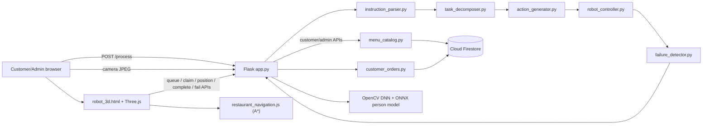
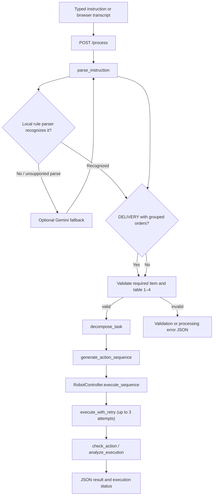
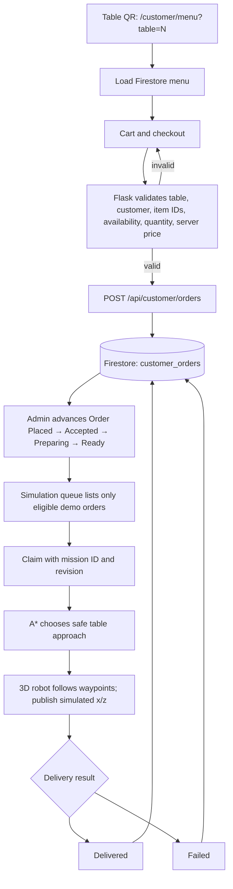
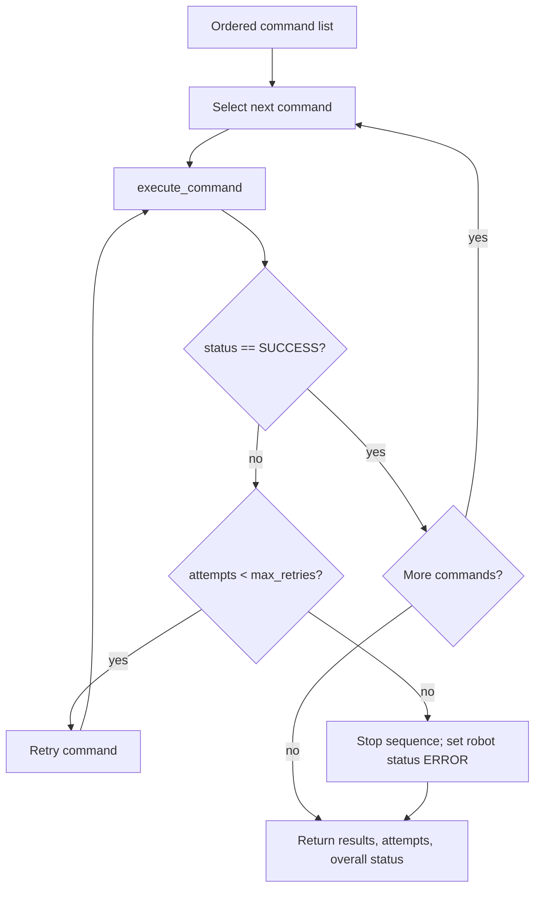
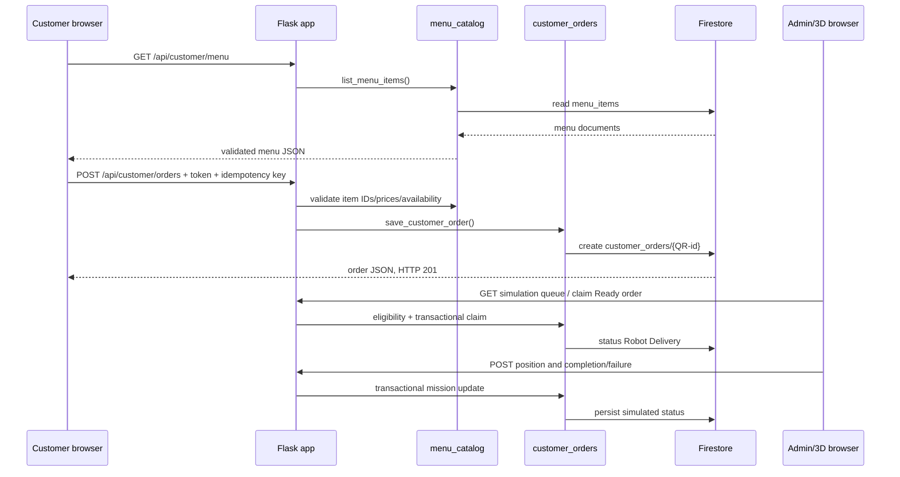
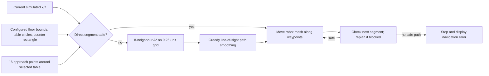

# AI Restaurant Service Robot
## Evidence-Based College Project Report Draft

> **Evidence boundary:** This report was prepared from the application source, configuration examples, templates, static assets, tests, and project documentation present in this workspace. It does not expose `.env` values, service-account contents, credentials, tokens, or customer records. Virtual environments, `node_modules`, and the vendored CALVIN repository were not inspected file-by-file. Features are labeled as implemented, configured, simulated, partial, or not verified.  
> **Current validation:** On 24 October 2026, Python unittest discovery ran **122 tests successfully** and Node's test runner ran **8 tests successfully**. These were software tests, using fakes/mocks where indicated; they do not certify live cloud services, devices, or physical robot behavior.

---

# Front Matter

## Title Page

**AI RESTAURANT SERVICE ROBOT**  
College Project Report

Submitted by: **[Student Name(s)]**  
Registration/Roll No.: **[Registration Number(s)]**  
Department: **[Department Name]**  
Institution: **[College/University Name]**  
Project Guide: **[Guide Name and Designation]**  
Academic Year: **[Academic Year]**  
Submission Date: **[Date]**

## Certificate Template

This is to certify that the project report titled **“AI Restaurant Service Robot”** is a record of project work carried out by **[Student Name(s)]**, **[Registration Number(s)]**, under my guidance at **[Institution Name]** during **[Academic Year]**. The work is submitted in partial fulfillment of the requirements for **[Degree/Course Name]**.

Guide: ____________________  Date: __________  
Head of Department: ____________________  Date: __________  
Institution Seal: ____________________

## Declaration Template

I/We declare that this report titled **“AI Restaurant Service Robot”** is prepared for academic submission by **[Student Name(s)]**. Project details are based on inspection of the current source code. Any external libraries, models, and third-party assets are acknowledged in the references. Institution-specific declarations and originality requirements should be added before submission.

Signature(s): ____________________  Date: __________

## Acknowledgement Template

I/We thank **[Project Guide Name]**, **[Department/Institution]**, and everyone who provided guidance and feedback during this project. We also acknowledge the maintainers of the frameworks, services, browser APIs, and pretrained detection model referenced in this report.

## Abstract

The AI Restaurant Service Robot is a Flask-based software project that combines a natural-language instruction interface, restaurant order management, Firebase-backed customer ordering, and a browser-based 3D robot simulation. The Python instruction pipeline extracts supported intents, menu items, quantities, and table destinations; decomposes them into ordered task steps; maps those steps to controller commands; and returns execution and failure status. Rule-based parsing is used for recognized instructions, with an optional Google Gemini parser fallback. Separately, customers can use table-specific QR links to browse a menu and submit demo orders. Flask validates those orders and stores them in Firestore. Ready demo orders can be selected by the 3D simulation, whose JavaScript A* navigator plans around modeled obstacles. The project also includes browser speech controls, camera capture, OpenCV-based person detection, admin tools, and analytics. The robot controller and 3D movement are simulations: no physical robot actuation was verified.

## Table of Contents

1. Introduction  
2. System Requirements and Feasibility  
3. System Architecture and Design  
4. Technologies Used  
5. Detailed Module Implementation  
6. Algorithms and Core Logic  
7. Database and API Design  
8. Frontend and User Interface  
9. Testing and Validation  
10. Results and Demonstration  
11. Security, Limitations, and Risks  
12. Conclusion and Future Scope  
References, Appendices, and Viva Questions

## List of Figures and Tables

**Figures**
1. Overall system architecture
2. Customer order lifecycle
3. Natural-language parsing and task-planning flow
4. Robot command execution and retry flow
5. Firestore and API interaction
6. Browser-side A* navigation flow

**Tables**
1. Verified technology inventory
2. Major module inventory
3. Firestore data fields
4. API endpoint summary
5. Automated test inventory and result
6. Report chapter-to-source and screenshot map

---

# Chapter 1 — Introduction

## 1.1 Background and motivation

Restaurant service includes customer communication, menu presentation, order handling, and delivery coordination. This project demonstrates how a natural-language interface and a restaurant web application can be combined with a visual robot simulation. It is intended as an academic software prototype—not as a deployed autonomous restaurant robot.

## 1.2 Problem statement

A user instruction such as “Deliver two water bottles to Table 3” is unstructured text. The software must identify what is requested, extract quantities and destinations, reject invalid destinations, sequence the required actions, and report failures without falsely claiming successful delivery. Separately, QR-based customer orders need server-side validation and a way to display their progress in a simulated restaurant.

## 1.3 Proposed solution

The system provides two related but distinct workflows:

1. **Natural-language instruction:** Flask receives text, parses it, builds task/action lists, runs the software controller, and returns a JSON result. The Three.js scene can visualize a successful `/process` plan.
2. **QR customer order:** A customer visits a table-specific menu page, checks out, and the backend saves a demo order in Firestore. Staff can move the order to `Ready`; the 3D simulation can claim and animate it using its own browser-side route planner.

The source does **not** show QR checkout invoking the NLP parser or Python `RobotController`.

## 1.4 Scope

**Implemented in code:** Flask pages and APIs; rule-based parser and Gemini fallback; task decomposition and action mapping; a retrying simulated Python controller; customer menu/cart/checkout; Firestore orders and admin management; table QR generation; admin login; analytics and customer aggregation; camera frame upload and person detection; browser voice APIs; 3D scene and A* navigation; automated tests.

**Outside verified scope:** Physical robot motion, ROS/Arduino communication, real food handling, payment processing, kitchen/POS integration, live hardware telemetry, sensor-verified delivery, or production deployment.

## 1.5 Objectives

- Parse supported English restaurant commands into structured fields.
- Validate destinations and customer order data before processing.
- Convert high-level task steps into ordered controller commands.
- Persist table-specific demo orders and enforce supported status transitions.
- Show obstacle-aware paths and simulated position in the 3D environment.
- Test software validation, simulated failures, order lifecycle behavior, and route-clearance logic.

No benchmark accuracy or operational performance target is claimed.

## 1.6 Expected outcomes

The expected output is a demonstrable software prototype: users can submit supported instructions; customers can submit validated demo orders; admins can manage menu/order records; and simulated robot movements can be shown in a 3D scene. Test results measure code behavior, not physical service quality.

---

# Chapter 2 — System Requirements and Feasibility

## 2.1 Functional requirements evidenced in source

- Render customer, admin, voice/camera, tracking, and 3D simulation pages.
- Parse typed text and browser-produced voice transcripts through `/process`.
- Extract supported intent, item, quantity, and table fields.
- Reject invalid or missing delivery destinations before controller execution.
- Decompose instructions and generate controller command sequences.
- Simulate command execution with retries and structured results.
- Serve and manage a Firestore menu, validate customer carts against current items/prices, and save customer demo orders.
- Generate six table-specific QR links when a valid base URL is configured.
- Advance demo order statuses and expose simulation claim, tracking, completion, and failure APIs.
- Display a browser camera preview, submit a frame, and run server-side person detection.
- Produce analytics from Firestore order records where Firebase is configured.

## 2.2 Non-functional requirements and constraints

- Server-side validation; bounded upload sizes; customer order token and same-origin checks.
- HTTPS for network use; loopback-only operation without configured TLS.
- External connectivity for Firebase, optional Gemini, CDN assets, and package installation.
- Browser support and permissions for WebGL, camera, microphone, and speech services.
- The project is a development/prototype application; it is not shown as production-hardened.

## 2.3 Software requirements

- Python 3.12.10 was active in `.venv` during inspection.
- Node.js 24.15.0 was available for JavaScript tests.
- Install Python dependencies from `requirements.txt`; Node manifest lists `dotenv` and `express`, but no application JavaScript imports them as a web server.
- A modern browser with JavaScript/WebGL. Localhost is used for local operation; HTTPS is needed for access from another device and browser media APIs.

## 2.4 External configuration

- Optional Gemini parsing requires `GEMINI_API_KEY` and external API access.
- Firebase-backed features require Firebase Admin service-account credentials; admin sign-in also requires a Firebase web API key and allowlisted admin UIDs.
- Customer identity linking across orders requires a stable `CUSTOMER_ID_HMAC_KEY`; without it, orders cannot be confidently linked by phone identity.
- Mobile QR access requires a trusted HTTPS certificate, a phone-reachable QR base URL, same trusted network, and appropriate firewall access. The provided `scripts/start-mobile-https.ps1` uses mkcert and validates a private network address.
- Camera detection requires the included ONNX model and OpenCV/NumPy; browser camera permission is separately required to capture the frame.
- Three.js and OrbitControls are loaded from jsDelivr CDN; the page also loads external fonts and Bootstrap CSS.

## 2.5 Feasibility

The software demonstration is feasible on a Windows development machine with the declared packages and optional external service configuration. The project is **not feasible as a real robot deployment from the inspected implementation alone**: no actuator driver, robotics middleware node, localization, physical emergency-stop, or sensor-confirmed handling path was found.

---

# Chapter 3 — System Architecture and Design

## 3.1 Overall architecture

The Flask application is the web server and integration point. It imports the Python parser, task decomposer, action generator, robot controller, and failure detector. It also serves customer/admin templates, authenticates administrators, calls Firestore helpers, and provides camera and tracking APIs. The browser simulation is a separate client-side system that uses Three.js and the custom JavaScript navigator.



**Explanation:** The top instruction pipeline and the lower Firestore/simulation path share the Flask server, but the Python controller does not call the JavaScript A* planner. The browser simulation does not call the NLP parser for a Firestore order.

## 3.2 Natural-language workflow



**Source:** [`app.py`](../app.py#L2625), [`instruction_parser.py`](../src/instruction_parser.py#L155), [`task_decomposer.py`](../src/task_decomposer.py#L7), [`action_generator.py`](../src/action_generator.py#L7), [`robot_controller.py`](../src/robot_controller.py#L543).

## 3.3 Customer QR order workflow



**Important:** The code and checkout interface label customer orders as demo-only. Checkout is not represented as payment, restaurant staff fulfillment, or automatic NLP execution.

## 3.4 Execution and recovery flow



`failure_detector.recovery_action` exists as a helper but the live retry loop is in `RobotController.execute_with_retry`.

## 3.5 Firestore/API interaction



## 3.6 Navigation flow



---

# Chapter 4 — Technologies Used

Versions below distinguish manifest values from the inspected active `.venv`. “Installed version” is a local environment observation, not a deployment lock.

| Technology | Version | Purpose and actual usage | Relevant files | Configuration/setup |
|---|---|---|---|---|
| Python | 3.12.10 active `.venv` | Backend, parser, data utilities, tests | `app.py`, `src/`, tests | Install Python requirements |
| Flask | 3.1.3 pinned and installed | Pages, APIs, session and request handling | `app.py`, templates | Loopback by default; TLS needed for LAN |
| HTML/CSS/JavaScript | Browser-native | Customer/admin interfaces and client logic | `templates/`, `static/` | Modern browser |
| Flask/Jinja templates | Flask version above | Server-rendered pages, form data, admin/customer pages | `templates/` | Served from Flask |
| Regex (`re`) | Python standard library | Local intent/item/table/quantity parsing, validation | `src/instruction_parser.py` | No external service |
| Google Gemini / `google-genai` | SDK 2.29.0 installed; unpinned in `requirements.txt` | Optional fallback parse through model string `gemini-3.6-flash`; not movement control | `src/instruction_parser.py` | `GEMINI_API_KEY`, internet; live API not tested |
| `python-dotenv` | 1.2.4 installed; unpinned | Loads local `.env` values | `app.py`, `firebase_db.py`, parser | Secret file/environment; do not publish values |
| Firebase Authentication | Firebase service; SDK/Admin 7.7.0 installed | Admin sign-in and UID-allowlisted session-cookie verification | `app.py`, `static/js/admin_login.js` | Web API key, enabled sign-in method, allowed admin UIDs |
| Cloud Firestore | Via Firebase Admin SDK | `menu_items` and `customer_orders`; orders and simulation state | `firebase_db.py`, `menu_catalog.py`, `customer_orders.py` | Server-only service-account JSON; network |
| OpenCV DNN | `opencv-python-headless` 4.11.0.86 installed | Infer person detections from uploaded camera frames | `app.py`, `models/person_detection_mediapipe/` | Included ONNX model, NumPy |
| MediaPipe-derived person detector | ONNX model file present; Python MediaPipe package not needed by this path | Pretrained person model loaded using OpenCV Zoo helper | `models/person_detection_mediapipe/mp_persondet.py`, `.onnx` | Model included; camera permission at capture |
| NumPy | 2.5.2 installed/pinned | OpenCV frame decoding and dataset utilities | `app.py`, dataset tools | Python dependency |
| Three.js + OrbitControls | r128 / 0.128.0 CDN | Restaurant and customer-tracking 3D scenes, camera controls | `templates/admin_dashboard/robot_3d.html`, `static/js/customer_robot_tracking.js` | WebGL and CDN access |
| Web Speech API | Browser-provided | Speech recognition (`en-IN`) and speech synthesis | Admin dashboard and `voice_camera.html` | Microphone permission, browser support, available voices |
| MediaDevices API | Browser-provided | Capture live camera stream for user-initiated person detection | `templates/admin_dashboard/index.html`, `voice_camera.html` | Camera permission and secure context |
| `qrcode` + Pillow | qrcode 8.2 and Pillow 13.0.0 installed | Generate QR PNG images in memory; validate uploaded food images | `app.py` | Python packages; no cloud QR API |
| Bootstrap | 5.3.3 CDN | Layout/style support on selected pages | Admin/customer templates | CDN access |
| Google Fonts | CDN fonts | Typography | Admin/customer templates, CSS | Network access |
| Node.js / Node test runner | v24.15.0 / npm 11.12.1 | Executes JavaScript tests | `tests/*.js` | Node installed |
| Node `dotenv`, `express` | 18.0.8 / 5.3.0 installed | Declared in `package.json`; no project server import found | `package.json` | Not part of Flask runtime |
| pandas, scikit-learn, requests | pandas 3.0.5, sklearn 1.9.1, requests 2.34.2 installed | Declared; no active instruction/order path use found | `requirements.txt` | Do not claim ML training or active use based on dependency declaration |
| `unittest` | Python standard library | Backend/API test suite | `tests/` | Run command in Chapter 9 |

`requirements.txt` pins Flask, NumPy, pandas, OpenCV, and qrcode; several other packages are unpinned. A full dependency lockfile for Python was not found.

---

# Chapter 5 — Detailed Module Implementation

## A. Natural-language parsing and Gemini fallback

**File:** [`src/instruction_parser.py`](../src/instruction_parser.py#L1)

- `find_word` checks phrases longest-first with word boundaries.
- `extract_table` accepts table number expressions such as “table number 4”.
- `extract_quantity` handles a narrow number-and-item expression; the multi-order parser has a broader quantity parser, including numbers and number words one through ten.
- `parse_delivery_orders` extracts known item phrases, associates each item with table mentions, and returns an `orders` list. Item records contain `name`, `quantity`, `status`, `delivery_status`, and `delivered_quantity`. Destinations outside the supported range are parsed and rejected later.
- `detect_restaurant_intent`, `rule_based_parser`, `validate_result`, and `extract_restaurant_object` handle supported intents and legacy pick-and-place terms.
- `gemini_parser` calls the Google GenAI SDK and validates returned JSON. `parse_instruction` tries deterministic parsing first and invokes Gemini when the local result does not adequately recognize the restaurant request. A Gemini failure falls back to the local parse result.

**Status:** Local parsing is active; Gemini is optional and requires a key/network. The supported vocabulary and phrasing are limited. No local trained NLP model is connected to `/process`.

## B. Task decomposition

**File:** [`src/task_decomposer.py`](../src/task_decomposer.py#L7)

`decompose_task(parsed_instruction)` returns an ordered `list[dict]` with `step`, `task`, and `description`. Intent branches include greeting, menu, guide, navigation, order, delivery, return, and legacy `PICK_AND_PLACE`. The delivery recipe has eight steps: detect object, move to object, pick, plan route, navigate to table, place, confirm delivery, and return.

The sequence is a fixed rule-based recipe. There is no generic dependency graph, scheduling engine, multi-robot scheduler, or route optimizer in this module.

## C. Action generation

**File:** [`src/action_generator.py`](../src/action_generator.py#L7)

`generate_action_sequence(decomposed_steps)` maps a task list into ordered action records: `{"step": n, "action": command, "source_task": task}`. Examples: `DETECT_OBJECT → DETECT`, `PICK → GRAB`, `NAVIGATE_TO_TABLE → NAVIGATE`, `PLACE → RELEASE`. Invalid list input returns an empty list; malformed or unmapped individual tasks are skipped.

## D. Python robot controller and retry handling

**File:** [`src/robot_controller.py`](../src/robot_controller.py#L7)

`RobotController` holds software fields such as status, logical location, battery value, customer-detected flag, picked-food flag, current table, and order state. `execute_command` dispatches command strings to methods such as `detect_customer`, `greet_customer`, `plan_route`, `navigate_to_table`, `move`, `grab`, `release`, and `return_to_counter`.

`execute_with_retry` retries a failed command up to `max_retries` (default 3). The controller injects a one-time failure for the first `MOVE` while `demo_failure` is enabled, demonstrating retry logic. `execute_sequence` runs commands serially, reports attempts, and stops on terminal failure.

**Simulation boundary:** Methods print messages and update in-memory state; `plan_route` does not calculate geometry. No motor, actuator, ROS, Arduino, sensor, or physical grasp feedback is called.

## E. Failure detection and recovery

**File:** [`src/failure_detector.py`](../src/failure_detector.py#L6)

- `check_action` returns a success boolean and message for one result.
- `analyze_execution` collects results with non-`SUCCESS` status.
- `recovery_action` returns a simple `RETRY`/`STOP` suggestion.

Flask uses `check_action` and `analyze_execution`. Retries come from the controller, not `recovery_action`. The separate [`failure_recovery.py`](../failure_recovery.py#L1) script injects simulated failure types and logs data; it is not the Flask controller’s recovery path.

## F. Flask backend and REST APIs

**File:** [`app.py`](../app.py#L1)

The application registers customer and admin page routes, authentication/session endpoints, menu/order/analytics APIs, simulation mission endpoints, `/detect-customer`, `/health`, `/process`, and robot tracking. Before-request handlers require admin authentication for protected pages/APIs, restrict insecure remote use, and enforce HTTPS for customer order APIs. The direct-run startup validates host/TLS settings before starting Flask.

`/process` parses input, validates destination/items, branches grouped delivery requests to `execute_delivery_orders`, and otherwise runs parser → decomposer → action generator → controller → failure analysis. Grouped delivery validates every table before constructing the controller, then calls the controller once per quantity unit.

## G. Customer menu, cart, checkout, and order validation

**Templates/scripts:** `templates/customer/`, [`static/js/customer.js`](../static/js/customer.js#L1).  
**Backend:** [`app.py`](../app.py#L1782), [`menu_catalog.py`](../menu_catalog.py#L179).

The menu page loads menu items from `/api/customer/menu`; the browser stores cart state and submits checkout to `/api/customer/orders`. The server checks table number (1–6), name, phone digit count, item IDs, availability, quantity limits, and price from the current server catalog. It computes the total server-side. The checkout interface states that no payment is collected and the order is a demo order.

The order response includes a one-time access token; the stored order contains its hash rather than the raw token. An idempotency key prevents accidental duplicate creation for the same request key.

## H. Firebase/Firestore integration

**Files:** [`firebase_db.py`](../firebase_db.py#L1), [`customer_orders.py`](../customer_orders.py#L1), [`menu_catalog.py`](../menu_catalog.py#L1).

Firebase initialization is lazy and cached. Credentials are read server-side from `FIREBASE_CREDENTIALS_PATH` or the default `config/firebase-service-account.json`. Collections observed in source:

- `menu_items`: menu document name, category, description, availability, price, and image path.
- `customer_orders`: order identity, table, item list, total, status/revision timestamps, token hash, demo marker, and simulation mission/position fields.

Transactions enforce order revision and status transition checks. Tests use an in-memory `MemoryFirestore` fake; they do not prove live Firebase availability.

## I. Admin dashboard and order management

**Files:** `templates/admin_dashboard/admin_base.html` and page templates; `static/js/admin_dashboard.js`, `static/js/admin_analytics.js`; APIs in `app.py`.

Admin pages cover overview, orders, menu, tables/QRs, customers, analytics, settings, robot tools, and tracking. Menu CRUD and customer orders are Firestore-backed when configured. Admin overview summary values and robot fleet cards include hard-coded demo values; these must not be described as live production telemetry. Analytics is separately populated from Firestore order records and has known unavailable fields, including average delivery time because start timestamps are not stored.

## J. Table QR-code generation and mobile access

`/admin/tables` generates six URLs (`/customer/menu?table=1` through `table=6`) and QR PNG data using Python `qrcode` and Pillow. `QR_BASE_URL`/`CUSTOMER_QR_BASE_URL` are validated. Local-only QR codes are explicitly labeled as not phone-ready. The mobile HTTPS launcher uses mkcert, binds only to a selected private LAN IPv4 address, and does not place certificates/private keys in the repository.

## K. Three.js simulation and navigation

**Files:** [`templates/admin_dashboard/robot_3d.html`](../templates/admin_dashboard/robot_3d.html#L903), [`static/js/restaurant_navigation.js`](../static/js/restaurant_navigation.js#L1).

The 3D page models a restaurant floor, counter, six tables, robot, tray/food marker, camera controls, telemetry, and mission controls. The custom navigator uses 2D `x/z` positions, configured bounds, circular table obstacles, and a rectangular counter obstacle. It plans at 0.25-unit grid resolution, uses robot radius 0.75 plus safety margin 0.2, creates 16 candidate table approaches, and returns `null` if no route is available. The template follows waypoints and has stop/error handling.

The simulated order API claims Firestore orders marked Ready, updates simulated coordinates, and records completion/failure. This is a browser-controlled visual simulation. The persisted position is simulation telemetry, not sensor telemetry.

## L. Voice and person detection

**Voice input:** The browser checks `SpeechRecognition` / `webkitSpeechRecognition`, sets locale `en-IN`, and forwards the transcript through the same instruction flow.  
**Voice output:** Browser `speechSynthesis` speaks responses; displayed text remains the fallback.  
**Camera/person detection:** Browser `getUserMedia` supplies a frame to `/detect-customer`; Flask uses OpenCV DNN with the included MediaPipe-derived person detector ONNX model and threshold 0.5. The detector returns bounding boxes and scores.

These are distinct features: speech recognition is browser-provided; person detection is server-side OpenCV inference. Real device permissions and audio/camera conditions require manual verification.

## M. Robot tracking, analytics, and customer management

- `/api/robot-tracking` reports process-local controller/simulation state and may refresh from Firestore simulation records. Some table occupancy statuses are hard-coded demonstration values.
- Customer aggregation groups records using HMAC-derived phone identity when configured and only presents phone last-four digits; older/unmatched records may remain separate.
- Analytics calculates weekly orders/value, popular dishes, and terminal simulation completion/failure totals. It deliberately returns no average delivery minutes because that timestamp data is absent.
- `admin_robot.html` is labeled simulation-only and contains sample robot cards/history, not live fleet control.

---

# Chapter 6 — Algorithms and Core Logic

## 6.1 Rule-based parsing

Inputs: instruction string. Outputs: intent and extracted item/table/quantity fields, sometimes an `orders` array. Regular expressions use case-insensitive matching and word boundaries. Multi-order parsing associates an item with the next table mention, or with the closest preceding table when the sentence structure permits it. Supported quantity words are one through ten; unknown words or unsupported item synonyms may require Gemini or remain unparsed.

Example simplified result:

```json
{
  "intent": "DELIVERY",
  "orders": [{
    "table": 3,
    "items": [{
      "name": "water bottle",
      "quantity": 2,
      "status": "VALIDATED",
      "delivery_status": "PENDING",
      "delivered_quantity": 0
    }]
  }]
}
```

The order ID is generated per parse and is intentionally omitted here.

## 6.2 Task decomposition and action sequencing

The decomposer selects a hard-coded task template from `intent`; the list position is the prerequisite/order representation. The action generator maps each task to a command. This is not a learned policy and does not reason over physical state.

## 6.3 Controller retries and result status

For each command, `execute_with_retry` performs at most three attempts and returns `{status, message, attempts}`. `execute_sequence` appends `{step, command, status, message, attempts}` and stops on a command that remains failed. Grouped order execution determines unit success only when `overall_status == SUCCESS`, at least one result exists, and all returned result statuses are `SUCCESS`. Item/order states are derived from successful unit counts; partial quantities are not reported as fully delivered.

## 6.4 A* path planning

The browser navigator uses A* with:

- nodes at 0.25-unit grid points within configured bounds;
- eight neighbor directions, including diagonals;
- edge costs equal to Euclidean segment length;
- heuristic equal to straight-line distance to the nearest candidate goal;
- a binary min-heap for selecting the lowest `g + h` score;
- parent links to reconstruct a path;
- collision tests on points and every segment.

The obstacle safety clearance is robot radius + margin (0.75 + 0.2). Circular table boundaries are expanded by this clearance; the rectangular counter is expanded in each direction. Path smoothing greedily replaces intermediate waypoints only if the straight segment still passes `segmentIsClear`. For a table destination, 16 points are generated around the table at `tableRadius + clearance + 0.35`; reachable plans are compared by route distance.

**Limitation:** A* optimizes on this finite grid and static simplified geometry. It is not a continuous-space proof of global optimality and does not use live sensor obstacles.

## 6.5 Order validation and status transitions

Order creation uses server-side menu values and bounded quantities. Firestore update transactions compare `revision` to prevent stale writes. Admin transitions advance `Order Placed → Accepted → Preparing → Ready`; terminal states cannot be changed. Simulation claim is limited to eligible `demo_only` orders in Ready state and records a mission ID and revision. Simulation completion/failure requires a matching active mission.

---

# Chapter 7 — Database and API Design

## 7.1 Firestore initialization

`firebase_db.py` reads the service-account file path from the environment or a default location, initializes Firebase Admin once under a lock, and caches the Firestore client. The service-account content is not included in this report.

## 7.2 Sanitized data shapes

**Menu document (`menu_items/{item_id}`):**

```json
{
  "name": "Garden Margherita",
  "category": "Pizza",
  "description": "Example description",
  "price": 18.5,
  "available": true,
  "image": "uploads/example.jpg"
}
```

**Customer demo order (`customer_orders/{QR-id}`):**

```json
{
  "table_number": 3,
  "items": [{"id": "menu-id", "name": "Example item", "price": 10.0, "quantity": 2}],
  "total": 20.0,
  "status": "Order Placed",
  "revision": 0,
  "demo_only": true,
  "order_access_token_hash": "[SHA-256 hash omitted]",
  "delivery_simulation_state": "[absent until simulation]"
}
```

The actual record also contains timestamps and limited customer identity fields; no personal customer record is reproduced.

## 7.3 API endpoint summary

All routes are registered in `app.py`. Admin endpoints require an authorized session except the sign-in/session endpoints. Customer menu/order pages are public, but order mutation/status access uses validation and a per-order access token. Remote customer order APIs require HTTPS.

| Method and path | Purpose | Main validation/result |
|---|---|---|
| `GET /` | Main robot dashboard | HTML |
| `GET /simulation` | 3D simulation | Admin-protected HTML |
| `GET /voice-camera` | Voice/camera interface | Admin-protected HTML |
| `GET /admin-login` | Admin sign-in page | Firebase configuration status |
| `POST/DELETE /api/admin/session` | Exchange Firebase ID token / sign out | Same-origin, UID allowlist, HttpOnly session cookie |
| `POST /api/admin/local-session` | Optional localhost-only development auth | Same-origin, local-only configuration |
| `GET /admin`, `/admin/orders`, `/admin/robot`, `/admin/menu`, `/admin/tables`, `/admin/customers`, `/admin/analytics`, `/admin/settings` | Admin pages | Admin session |
| `GET/POST /api/admin/menu` | Read/seed or create menu items | Auth; validated fields; Firestore |
| `PUT/DELETE /api/admin/menu/<id>` | Update/delete menu item | Valid ID, same-origin, field/image checks |
| `POST /api/admin/menu-images` | Upload food image | Size/type/image-content validation |
| `GET /api/admin/customers` | Customer aggregation | Admin auth; Firestore |
| `GET /api/admin/analytics` | Order analytics | Admin auth; Firestore/timezone/currency validation |
| `GET /admin/tables` | Generate and show QR codes | Valid configured base URL |
| `GET /customer/menu`, `/customer/cart`, `/customer/checkout`, `/customer/order-status`, `/customer/robot-tracking`, `/customer/my-orders` | Customer pages | Table query parsed as 1–6 where applicable |
| `GET /api/customer/menu` | Public menu data | Firestore; no-store response |
| `POST /api/customer/orders` | Create demo order | Same origin, HTTPS remotely, table/customer/items validation, token, optional idempotency key |
| `GET/PUT/DELETE /api/customer/orders/<id>` | Read/update/cancel own order | Access token and revision/state validation |
| `GET /api/customer/orders/<id>/tracking` | Read simulated tracking | HTTPS remotely and access token |
| `PUT /api/admin/orders/<id>` | Advance/cancel/fail order status | Admin auth, allowed transition, expected revision |
| `GET /api/admin/simulation/orders` | Queue ready demo orders | Admin auth; eligible demo orders only |
| `POST /api/admin/simulation/orders/<id>/claim` | Claim delivery mission | Mission UUID, revision, Ready state |
| `POST /api/admin/simulation/orders/<id>/position` | Persist simulated x/z and moving state | Mission UUID, finite coordinate bounds, active mission |
| `POST /api/admin/simulation/orders/<id>/complete` | Mark simulation delivered | Active matching mission |
| `POST /api/admin/simulation/orders/<id>/fail` | Mark simulation failed | Active matching mission |
| `POST /detect-customer` | Detect people in submitted camera frame | JPEG/image decoding, 5 MB and 4096px limits, model availability |
| `GET /health` | Static health summary | Module flags are constants, not readiness probes |
| `POST /process` | NLP instruction and software controller flow | JSON instruction, parser/decomposition/action/table checks |
| `GET /robot-tracking` | Admin tracking page | Admin session |
| `GET /api/robot-tracking` | Controller/simulation tracking data | Firestore refresh may be unavailable/stale |

## 7.4 Response/error conventions

Responses generally include `success`, `error` or `robot_response`, and additional structured fields. Validation failures return 4xx; unavailable Firebase/model resources often return 503. Multi-order controller failures can be represented in JSON with HTTP 200, so clients must inspect `success`, `overall_status`, and per-item status rather than treating HTTP 200 alone as delivery success.

---

# Chapter 8 — Frontend and User Interface

## 8.1 Customer interface

Customer pages are in `templates/customer/`, with shared behavior in `static/js/customer.js` and styling in `static/css/customer.css`. The user scans a QR code, sees the table context, loads the menu, filters/searches, adds cart items, reviews the cart, and submits checkout details. Prices and availability are revalidated server-side. Payment is not collected; this is stated in the checkout UI.

## 8.2 Admin interface

`templates/admin_dashboard/admin_base.html` contains shared navigation and frame. Page templates include overview, order, menu, table QR, customer, analytics, robot, settings, tracking, and 3D simulation. `static/js/admin_dashboard.js` and `static/js/admin_analytics.js` call backend APIs.

The overview and robot fleet-management page include fictional/demo summary cards and controls. They are not live multi-robot fleet management. Firestore-backed order/menu/customer/analytics pages are data-driven subject to configuration.

## 8.3 Admin login

`static/js/admin_login.js` calls Firebase Email/Password sign-in, submits the Firebase ID token to Flask, and receives a server-created HttpOnly session cookie after UID authorization. A local development login path is separately gated to localhost.

## 8.4 Voice and camera

The admin dashboard can request a camera stream, capture an image for `/detect-customer`, and start Web Speech recognition. Voice transcripts are sent through `/process`. Speech synthesis reads returned text. Both APIs depend on the browser, permissions, and device availability.

## 8.5 3D simulation and tracking

`robot_3d.html` renders the restaurant and offers simulation controls such as start/pause/reset/follow, mission/event status, telemetry, and interactive camera controls. `static/js/restaurant_navigation.js` provides paths. `static/js/customer_robot_tracking.js` builds a separate Three.js tracking visual and consumes tracking data. These visuals represent simulated coordinates, not robot sensor telemetry.

## 8.6 Screenshots recommended for the report

Capture screenshots yourself from the running app; none are fabricated in this report:

1. Admin sign-in page — authentication setup section.
2. Customer menu with table context and item cards — customer workflow.
3. Cart/checkout showing demo-only/no-payment label — order validation.
4. Admin tables page with generated QR code and base URL label — QR feature.
5. Admin orders page with one sanitized test order — Firestore management.
6. Admin analytics page after test data is available — analytics module.
7. `/simulation` with a route around a table and the controls visible — path planning.
8. Voice/camera page with permission granted and a test detection — optional device features.
9. Task planning diagram in this report — software pipeline.

Do not include real customer data, tokens, credentials, `.env`, or private certificates in screenshots.

---

# Chapter 9 — Testing and Validation

## 9.1 Automated test inventory

| Test file | Main coverage |
|---|---|
| `tests/test_parser.py` | Local delivery/navigation parse, Gemini fallback mock, invalid table rejected before execution |
| `tests/test_multi_orders.py` | Multiple item/quantity/table grouping, missing destination, invalid table, partial/failed quantity, pipeline delegation |
| `tests/test_robot_responses.py` | Flask `/process` response behavior, validation, success/failure wording, simulation auth/page checks |
| `tests/test_restaurant_navigation.js` | Safe approaches to all six tables, table detours, blocked route, unreachable wall, unsafe target |
| `tests/test_customer_qr_ordering.py` | Customer pages/table range, secure checkout, server-side catalog pricing, same-origin and QR order rules |
| `tests/test_firestore_orders.py` | Firestore fake, auth, order revisions/status transitions, simulation claim/position/complete/fail |
| `tests/test_customer_detection.py` | Missing/malformed/blank frames and positive detector response schema |
| `tests/test_admin_customers.py` | Admin customer API/auth, aggregation and privacy behavior |
| `tests/test_menu_management.py` | Menu CRUD, image validation, customer menu consistency |
| `tests/test_analytics.py` | Analytics aggregation, timezone, Firestore queries, invalid count responses |
| `tests/test_local_admin_bypass.py` | Restricted local development auth |
| `tests/firestore_fakes.py` | In-memory test double, not a test case by itself |
| `tests/test_admin_analytics_frontend.js` | Frontend handling of analytics API responses/errors |

## 9.2 Tests executed for this report

| Command | Result |
|---|---|
| `.\.venv\Scripts\python.exe -m unittest discover -s tests -v` | **122 tests run; all passed** |
| `node --test tests/test_restaurant_navigation.js tests/test_admin_analytics_frontend.js` | **8 tests; all passed** |

These tests use Flask's test client, Firestore fakes, mocks, sample frames, and route geometry. The positive person detector test mocks the inference output. They do not verify real Firebase credentials/cloud behavior, a live Gemini request, microphones, audible speech, real camera placement, or physical robot motion.

## 9.3 Suggested manual checks (not claimed as run)

- Sign in with a configured Firebase admin and confirm an unauthorized account is denied.
- On localhost, place a QR demo order and verify it appears in Firestore/admin orders.
- Mark an order through Accepted → Preparing → Ready, claim it in the 3D simulator, and inspect status/position updates.
- Use a phone only with the trusted HTTPS launcher and a trusted local certificate; scan one table QR and submit a demo order.
- Test the Web Speech APIs and camera permissions on target browsers.
- Test Gemini only with a valid key and explicit cost/quota awareness.
- Exercise routes to a blocked-direct-route table in the browser, then verify waypoint movement and return-to-counter behavior.

---

# Chapter 10 — Results and Demonstration

## 10.1 Verified outcomes

- Source contains both a local parser and optional Gemini fallback.
- Backend tests verify instruction validation, order status and response behavior, menu/QR checkout, Firestore transaction logic through a fake, camera endpoint response handling, and admin access checks.
- JavaScript tests verify every table has a safe approach in the modeled geometry, a route detours around intervening obstacles, a complete barrier yields no route, and a target within a table collision boundary is rejected.
- The current test run completed 122 Python tests and 8 JavaScript tests successfully.

## 10.2 Sanitized instruction example

Input: **“Deliver two water bottles to Table 3.”**

1. Parser identifies a delivery, quantity two, and Table 3.
2. Flask validates Table 3 against the NLP route’s supported range (1–4).
3. The multi-order executor loops over two item units.
4. For each unit, the decomposer creates the delivery recipe and the action generator maps tasks to commands.
5. The simulated controller returns results; Flask reports delivered/partial/failed status based on those results.
6. Successful response data can be displayed in the browser simulation; this does not establish a physical delivery.

## 10.3 Sanitized customer order example

Input: table 6, one currently available menu item, and valid customer details. Flask reads the Firestore menu, calculates price and total itself, creates a `demo_only` order, and returns HTTP 201 plus the order and a per-order access token. Staff can advance its state to `Ready`; only then may the browser simulation claim it. It is not sent to payment processing, restaurant POS, or the NLP `/process` route.

## 10.4 Demonstration checklist

1. Start the local server and sign in to the admin portal if Firebase admin setup is complete.
2. Use the dashboard instruction input for a supported delivery or navigation command and inspect the returned plan/status.
3. Use the 3D simulation and select a table whose direct path is obstructed; observe the safe route and table approach. The automated test suite covers this route logic; a live authenticated browser acceptance run is **not claimed here**.
4. Open **Tables & QR codes**, scan only a phone-ready HTTPS QR, place a demo order, and have an admin mark it Ready.
5. Start the simulation mission and observe Firestore-backed simulated status and tracking changes.

---

# Chapter 11 — Security, Limitations, and Risks

## 11.1 Security controls present

- Admin pages and APIs use Firebase-authenticated session cookies and UID allowlisting.
- Admin cookie is HttpOnly, SameSite=Lax, and Secure on HTTPS.
- Customer order API uses same-origin checks, HTTPS for remote connections, size/rate limits for public demo checkout, order-access-token hashing, and optional idempotency keys.
- Menu images have size, extension, decoded format, dimension, and image-content checks.
- Order values and prices are validated server-side; status updates enforce revision and allowed transitions.
- The startup code rejects non-loopback hosting without TLS. The provided mobile script validates private IPv4 and a Private network profile.

## 11.2 Risks and limitations

- Flask's built-in development server is not a production serving stack. Do not expose it directly to the public internet.
- `/process` has a broad exception path that prints and returns the exception text; production errors should be logged privately and returned generically.
- `/health` reports constant module flags; it is not a readiness check for Firebase, Gemini, camera, microphone, or hardware.
- The public demo mode and customer order endpoint require careful limits, HTTPS, trusted URL configuration, and firewall/network protection.
- Gemini prompts and response handling do not make output safe for physical actuation.
- Order/customer data requires access, retention, and consent policies. The project is a demo and does not implement payment.
- The table range differs by workflow: natural-language delivery accepts **Tables 1–4**; QR customer ordering and the 3D simulation support **Tables 1–6**.
- Customer checkout does **not** automatically invoke `/process` or the Python controller.
- Robot and fleet status cards contain demo values. Dashboard visuals and Firestore simulated tracking must not be described as production real-time robot telemetry.
- Static obstacle geometry does not detect a newly moved chair, person, tray, or other dynamic obstacle.
- No physical actuator interface, hardware E-stop, sensor-backed localization, collision safety, or physical delivery confirmation was found.

## 11.3 Documentation inconsistencies found

The checked-in documentation is not fully synchronized with current source:

- `project_documentation/02_TECHNOLOGY_STACK.txt` says OpenCV/MediaPipe were not found in app flow, while current `app.py` has a `/detect-customer` endpoint, OpenCV DNN inference, and the model/helper files.
- `project_documentation/03_PROJECT_STRUCTURE.txt` describes an older template/static layout; current pages are organized under `templates/admin_dashboard/`, `templates/customer/`, and the CSS/JS directories.
- `project_documentation/15_ROBOT_SIMULATOR.txt` describes four tables and an older static route approach; current scene has six table positions and uses `restaurant_navigation.js`.
- `project_documentation/25_CURRENT_PROJECT_STATUS.txt` and `27_PROJECT_REPORT_AND_VIVA.txt` describe no Firestore order persistence and no CV customer detector, which conflicts with current `customer_orders.py`, `firebase_db.py`, `app.py`, model files, and tests.
- Root `README.md` is empty.

The source and current automated tests were treated as primary evidence in this report.

---

# Chapter 12 — Conclusion and Future Scope

## 12.1 Conclusion

The project is a multi-feature restaurant software prototype. It combines natural-language instruction parsing and task sequencing, a simulated Python command controller, customer QR ordering backed by Firestore, admin APIs and pages, camera person detection, browser voice functions, and a Three.js simulation with A* navigation. Tests demonstrate many software contracts and simulated route constraints.

## 12.2 Current achievements supported by code and tests

- Structured instruction parsing, validation, decomposition, command generation, and status reporting.
- Multi-item/multi-table software order execution with partial/failure accounting.
- Customer demo-order persistence and revision-checked status lifecycle.
- Securely scoped admin sessions and customer order access checks.
- Model-backed person detection endpoint.
- A* detours and safe table approaches in the 3D geometry.
- Passing automated Python and JavaScript test suites in the current environment.

## 12.3 Future improvements (not completed features)

- Unify or explicitly document the two delivery pipelines and table ranges.
- Improve parser ambiguity resolution, multilingual support, and catalog grounding.
- Add true live obstacle sensing and localization only if a hardware system is planned.
- Design hardware integration with validated safety architecture, emergency stop, fail-safe behavior, and independent sensor verification before any robot is connected.
- Add persisted execution audit records and better operational monitoring.
- Add browser end-to-end tests for the full QR-to-simulation lifecycle.
- Harden production deployment, dependency pinning, privacy retention, generic errors, and secret rotation.
- Update README and stale project documentation to match current source.
- Remove or explain unused dependencies and legacy dataset scripts if they are no longer needed.

---

# References

## Project sources

- [`app.py`](../app.py)
- [`src/instruction_parser.py`](../src/instruction_parser.py)
- [`src/task_decomposer.py`](../src/task_decomposer.py)
- [`src/action_generator.py`](../src/action_generator.py)
- [`src/robot_controller.py`](../src/robot_controller.py)
- [`src/failure_detector.py`](../src/failure_detector.py)
- [`customer_orders.py`](../customer_orders.py)
- [`firebase_db.py`](../firebase_db.py)
- [`menu_catalog.py`](../menu_catalog.py)
- [`analytics.py`](../analytics.py)
- [`static/js/restaurant_navigation.js`](../static/js/restaurant_navigation.js)
- [`templates/admin_dashboard/robot_3d.html`](../templates/admin_dashboard/robot_3d.html)
- [`requirements.txt`](../requirements.txt), [`package.json`](../package.json), [`.env.example`](../.env.example)

## Official technical documentation

- Python: https://docs.python.org/3/
- Flask: https://flask.palletsprojects.com/
- Firebase Admin SDK: https://firebase.google.com/docs/admin/setup
- Cloud Firestore: https://firebase.google.com/docs/firestore
- Gemini API: https://ai.google.dev/gemini-api/docs
- OpenCV DNN: https://docs.opencv.org/4.x/d6/d0f/group__dnn.html
- Three.js: https://threejs.org/docs/
- Web Speech API: https://developer.mozilla.org/en-US/docs/Web/API/Web_Speech_API
- MediaDevices `getUserMedia`: https://developer.mozilla.org/en-US/docs/Web/API/MediaDevices/getUserMedia
- Node.js: https://nodejs.org/docs/latest/api/

---

# Appendices

## Appendix A — Major module/file inventory

| Area | Files | Responsibility |
|---|---|---|
| Flask application | `app.py` | Routes, auth, validation, APIs, startup/TLS checks, orchestration |
| NLP/planning | `src/instruction_parser.py`, `src/task_decomposer.py`, `src/action_generator.py` | Parse, decompose, map tasks to actions |
| Controller/failure | `src/robot_controller.py`, `src/failure_detector.py` | Simulated command state/retries and result analysis |
| Separate CLI | `integrated_pipeline.py` | Command-line pipeline using shared modules |
| Firestore | `firebase_db.py`, `customer_orders.py`, `menu_catalog.py`, `analytics.py` | Firebase initialization, order/menu operations, analytics |
| Browser frontend | `templates/`, `static/css/`, `static/js/` | Customer/admin UI, API calls, voice/camera UI, tracking |
| 3D simulation | `templates/admin_dashboard/robot_3d.html`, `static/js/restaurant_navigation.js` | Three.js scene, A* routing, simulated mission motion |
| Person detection | `models/person_detection_mediapipe/` | OpenCV helper, ONNX model, license |
| QR/mobile setup | `app.py`, `scripts/start-mobile-https.ps1`, `MOBILE_ORDER_TESTING.md` | QR URL generation and secure local-network startup |
| Tests | `tests/` | Unit/API/route/frontend tests; Firestore fake |
| Data/evaluation | `data/`, `datasets/`, dataset scripts, evaluation scripts | Data preparation and offline experiments, not connected to web inference |
| Legacy/demo | `task_decomposer_robot.py`, `failure_recovery.py`, `src/config_loader.py`, `config/robot_config.json`, `test_controller.py` | Separate/older task demo, config print, synthetic failure demo |

## Appendix B — Installation and safe startup

From the project root in PowerShell:

```powershell
.\.venv\Scripts\python.exe -m pip install -r requirements.txt
.\.venv\Scripts\python.exe app.py
```

The app should stay loopback-only unless a valid TLS configuration is provided. For phone QR testing, follow `MOBILE_ORDER_TESTING.md` and `scripts/start-mobile-https.ps1` on a trusted private LAN. Do not change the host to `0.0.0.0`, disable HTTPS protections, expose private keys, or share service-account credentials. Firebase admin setup is required for protected admin pages and Firestore features. Gemini is optional.

Automated tests:

```powershell
.\.venv\Scripts\python.exe -m unittest discover -s tests -v
node --test tests/test_restaurant_navigation.js tests/test_admin_analytics_frontend.js
```

## Appendix C — Dataset and training status

The workspace contains CSV/JSON data and scripts for generation, combination, extraction, standardization, splitting, and evaluation, including a vendored CALVIN subtree. No training pipeline or trained NLP model was found connected to `app.py` or `parse_instruction`. The active NLP method is rule-based parsing plus optional remote Gemini fallback. Dataset artifacts should not be presented as training results without separately reproducing and validating the relevant experiment.

## Appendix D — Report chapter-to-source and screenshot mapping

| Report section | Main evidence | Recommended visual |
|---|---|---|
| Chapters 1–2 | `app.py`, `project_documentation/01_PROJECT_OVERVIEW.txt` | Project title slide / problem summary |
| Chapter 3 | `app.py`, `src/`, `customer_orders.py`, simulation JS/HTML | Architecture diagrams in Chapter 3 |
| Chapter 4 | `requirements.txt`, `package.json`, `.env.example`, imports | Technology stack table |
| Chapter 5 | Source files in Appendix A | Dashboard or relevant module screenshot |
| Chapter 6 | Parser/planner/controller/navigation files | Task sequence and A* route diagram |
| Chapter 7 | `customer_orders.py`, `menu_catalog.py`, `app.py` | Sanitized Firestore/API flow |
| Chapter 8 | `templates/`, `static/` | Menu, checkout, admin QR, analytics, simulation |
| Chapter 9 | `tests/` | Test summary output (redact machine-specific paths if desired) |
| Chapter 10 | Test outputs and manual demo | 3D route/delivery screenshot, only if personally captured |
| Chapter 11 | auth/HTTPS validation and limitations in source | Security boundary diagram/checklist |
| Chapter 12 | Verified implementation and gaps | Future-scope slide |

---

# Twenty Likely Viva Questions and Answers

1. **What does the project do?**  
   It demonstrates natural-language robot-style commands, restaurant QR ordering, admin order management, and a separate 3D robot simulation.

2. **Which language is used for the backend?**  
   Python with Flask.

3. **How does instruction parsing work?**  
   Regular-expression and rule-based parsing handles recognized instructions; Gemini is an optional fallback for unsupported cases.

4. **Does Gemini control the robot?**  
   No. Gemini returns structured parser data; Flask then uses the project’s task/action/controller code.

5. **What is task decomposition?**  
   It maps an intent to an ordered list of high-level steps, such as detect, pick, navigate, place, and return.

6. **How are tasks converted to commands?**  
   `generate_action_sequence` maps task labels such as `PICK` and `NAVIGATE_TO_TABLE` to controller commands such as `GRAB` and `NAVIGATE`.

7. **How does the Python controller handle failure?**  
   It retries a failed command up to three attempts and stops the sequence after terminal failure.

8. **Is the Python `plan_route` method A*?**  
   No. It returns a simulated success message. A* is in the browser JavaScript navigation module.

9. **How does the 3D path planner avoid tables?**  
   It searches a grid, rejects unsafe segments based on expanded obstacle boundaries, and smooths only line-of-sight-safe paths.

10. **Is the 3D route continuously optimal?**  
    No guarantee. It is an approximate shortest route on the configured grid and static geometry.

11. **How is the robot kept away from table edges in the simulation?**  
    The planner expands table obstacles by the robot radius plus a safety margin, and chooses an approach point outside that boundary.

12. **What happens if no route is found?**  
    The navigator returns no plan; the simulation stops and shows a navigation error rather than appending a direct route through obstacles.

13. **How do customer QR orders get stored?**  
    Flask validates the submission and writes a `demo_only` document to the Firestore `customer_orders` collection.

14. **Does checkout automatically start the NLP robot pipeline?**  
    No. It is a separate workflow. A Ready order can be claimed by the browser simulation through simulation APIs.

15. **What is the difference between Firestore and browser session storage here?**  
    Firestore stores customer demo orders and simulation mission state; session storage is browser-local temporary data used for some instruction simulation flow.

16. **How are customer prices protected from client tampering?**  
    The server reloads menu items and calculates prices/totals; the client submits menu IDs and quantities, not trusted prices.

17. **Is customer recognition implemented?**  
    Yes, a browser camera can submit a frame to a Flask endpoint that runs OpenCV DNN using an included person-detection ONNX model. It still requires camera permission and real-world validation.

18. **How does voice input work?**  
    The browser Web Speech API recognizes speech with locale `en-IN`; the resulting transcript is sent through the same `/process` endpoint as typed text.

19. **Is the project connected to a physical robot?**  
    No physical robot driver or hardware-control path was verified. Python commands and Three.js motion are simulations.

20. **What tests were run and what do they prove?**  
    122 Python unit tests and 8 JavaScript tests passed in the inspected environment. They validate software behavior with fakes/mocks and modeled geometry, not live cloud services, physical delivery, or hardware safety.

## Details to fill in before submission

- Student name(s), roll/registration number(s), department, college, university.
- Project guide, department head, academic year, submission date.
- Institution-specific certificate, declaration, acknowledgement, formatting, and citation style.
- Actual screenshots captured from the configured demo, with customer information and secrets redacted.
- Confirmation from the project team about any features or demonstrations performed outside the repository evidence summarized here.
